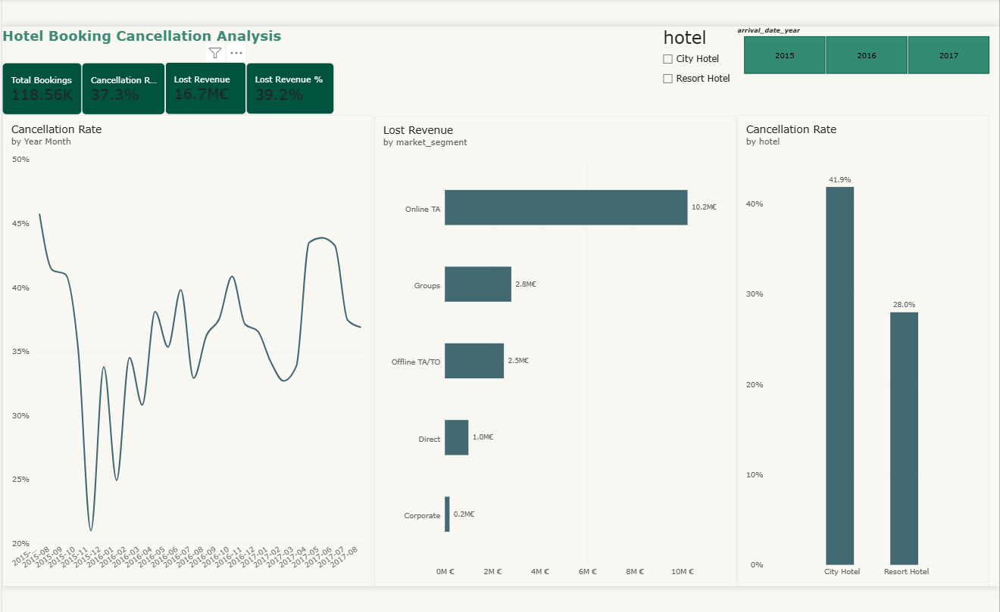
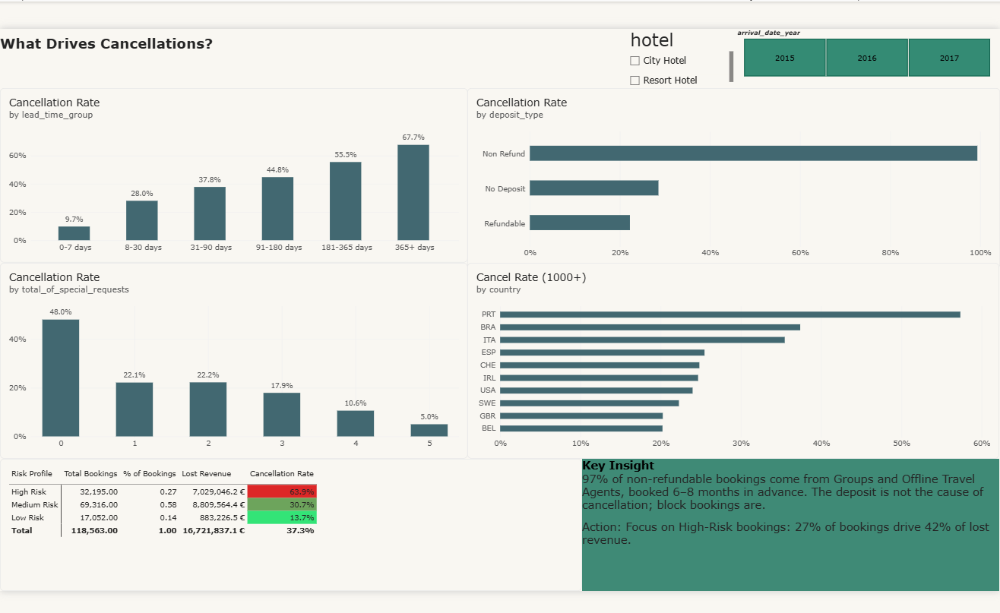

# 🏨 Hotel Booking Cancellation Analysis

**Reducing revenue loss from hotel booking cancellations — an end-to-end analysis using Python, SQL and Power BI.**



---

## 📌 Business Problem

More than **1 in 3 hotel bookings are canceled**, leaving rooms empty and revenue unrealized.
This project analyzes ~119K bookings from two hotels in Portugal to answer:

1. How much revenue is lost to cancellations?
2. Which booking characteristics predict a cancellation?
3. What can hotel management do to reduce the loss?

---

## 📊 Key Numbers

| Metric | Value |
|---|---|
| Bookings analyzed | **118,563** |
| Cancellation rate | **37.3%** |
| Expected revenue lost to cancellations | **€16.7M** (39.2% of expected revenue) |

---

## 🔍 Key Insights

1. **Lead time is the strongest driver.** Cancellation rises from **9.7%** for bookings made within a week to **67.7%** for bookings made more than a year ahead — a 7x increase.
2. **The deposit paradox.** Non-refundable bookings cancel **99.4%** of the time. SQL investigation showed that **97%** of them come from Groups (62.9%) and Offline Travel Agents (34.3%), booked **189–232 days** in advance on average. These are agency block bookings, not individual decisions — the deposit is not the cause. *Correlation ≠ causation.*
3. **Domestic guests drive cancellations.** Portugal (PRT) represents ~40% of bookings but ~62% of all cancellations, with a **57.3%** cancellation rate vs 20–37% for other major countries.
4. **Online Travel Agents cause the largest loss.** Online TA accounts for **€10.2M** of lost revenue, while Direct bookings cancel at only **15.5%**.
5. **Commitment signals matter.** Guests with no special requests cancel at **48%**, falling to **5%** for guests with 5 requests. Repeated guests cancel **2.4x less** than new guests (15.7% vs 37.9%).
6. **City Hotel cancels more** than Resort Hotel (41.9% vs 28.0%).
7. **A simple risk rule works.** Bookings with lead time > 90 days, no special requests and a new guest are **27% of bookings** but cancel at **63.9%** and account for **42% of lost revenue**.



---

## 💡 Recommendations

| # | Recommendation | Based on |
|---|---|---|
| 1 | Require a partial deposit for bookings made **90+ days** in advance | Lead time insight |
| 2 | Add a **release date** (e.g. 30 days before arrival) to group and agency contracts | Deposit paradox |
| 3 | Incentivize **direct bookings** (discounts, perks) to reduce reliance on high-cancellation channels | Channel insight |
| 4 | Launch a **loyalty program** to convert new guests into repeat guests | Repeated guests insight |
| 5 | Automatically flag **High-Risk bookings** for reminders, deposits and overbooking planning | Risk rule |

---

## 🛠️ Tools & Skills

| Tool | Used for |
|---|---|
| **Python** (pandas, NumPy) | Data cleaning, feature engineering |
| **Python** (matplotlib, seaborn) | Exploratory data analysis, reusable plotting function |
| **SQL** (SQLite) | Business questions, aggregations, investigation |
| **Power BI** (DAX, Power Query) | Interactive 2-page dashboard |

**SQL techniques:** `GROUP BY` · `HAVING` · `CASE WHEN` · CTEs · Window functions (`OVER`, `PARTITION BY`, `LAG`, `RANK`, running totals)

**DAX techniques:** Measures vs calculated columns · `DIVIDE` · `CALCULATE` with `REMOVEFILTERS` · `SWITCH(TRUE())` · Top N filters · Synced slicers · Conditional formatting

---

## 🔄 Project Workflow

### 1. Data Cleaning — [`01_data_cleaning.ipynb`](notebooks/01_data_cleaning.ipynb)
- Dropped `company` (94% missing); filled `agent` (→ 0), `country` (→ "Unknown") and `children` (→ 0)
- Removed **827 invalid rows** (<1%): bookings with no guests, negative or extreme prices (ADR ≥ 1,000), and zero-night stays
- **Kept duplicate rows**: the dataset has no booking ID, so identical rows most likely represent separate rooms in group bookings
- Engineered features: `total_nights`, `total_guests`, `revenue`, `lost_revenue`, `arrival_date`, `lead_time_group`, `room_changed`

### 2. Exploratory Analysis — [`02_eda.ipynb`](notebooks/02_eda.ipynb)
- Built one reusable function to chart the cancellation rate by any dimension
- Analyzed 7 dimensions: hotel type, lead time, deposit type, market segment, guest type, special requests, month

### 3. SQL Analysis — [`03_sql_analysis.ipynb`](notebooks/03_sql_analysis.ipynb) · [`hotel_analysis.sql`](sql/hotel_analysis.sql)
- 10 queries, from overall KPIs to monthly trends (`LAG`, running totals), segment ranking (`RANK` + `PARTITION BY`) and a booking risk profile
- Used SQL to investigate and explain the deposit paradox

### 4. Power BI Dashboard — [`hotel_cancellation_dashboard.pbix`](dashboard/hotel_cancellation_dashboard.pbix)
- **Page 1 – Overview:** KPI cards, monthly trend, hotel comparison, lost revenue by channel
- **Page 2 – Cancellation Drivers:** lead time, deposit type, special requests, top countries, risk profile matrix
- Slicers for hotel and year, synced across both pages

---

## ⚠️ Limitations

- **Lost revenue is expected revenue** (ADR × nights) from canceled bookings. Non-refundable deposits were likely retained, so the actual loss is lower.
- Data covers **July 2015 – August 2017**. July and August appear in three years and other months in two, so months are compared by **rate**, not total.
- Prices are in **EUR**; both hotels are in Portugal, so results may not generalize to other markets.
- The risk rule is descriptive, based on observed patterns; it is not a trained predictive model.

---

## 📁 Project Structure

```
hotel-cancellation-analysis/
├── data/                      # not included — see "How to Run"
├── notebooks/
│   ├── 01_data_cleaning.ipynb
│   ├── 02_eda.ipynb
│   └── 03_sql_analysis.ipynb
├── sql/
│   └── hotel_analysis.sql
├── dashboard/
│   ├── hotel_cancellation_dashboard.pbix
├── images/                    # EDA charts and dashboard screenshots
└── README.md
```

---

## ▶️ How to Run

1. Download `hotel_bookings.csv` from [Kaggle – Hotel Booking Demand](https://www.kaggle.com/datasets/jessemostipak/hotel-booking-demand) and place it in `data/`
2. Install the libraries:
   ```bash
   pip install pandas numpy matplotlib seaborn jupyter
   ```
3. Run the notebooks in order: `01` → `02` → `03`
4. Open the `.pbix` file in Power BI Desktop and point the data source to `data/hotel_bookings_clean.csv`

---

## 📚 Data Source

Hotel Booking Demand dataset — originally published by Antonio, Almeida & Nunes (2019), *Data in Brief*. Available on [Kaggle](https://www.kaggle.com/datasets/jessemostipak/hotel-booking-demand).

---

## 👤 Author

**Abdulaziz Al Jaaidi**
[LinkedIn](https://www.linkedin.com/in/abdulaziz-al-jaaidi-755493443/) · [Email](Abdulaziz.AlJaaidi@hotmail.com)
